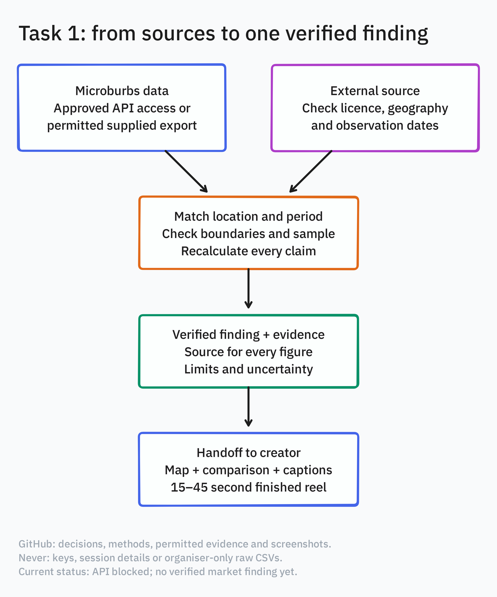
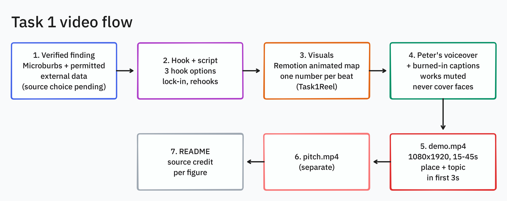

# microburbs-task1
Microburbs Hackathon Task 1: evidence, social creative and team delivery tracking

we'll use a instagram account today

jthk and jthk's Grok Bot are in.

## Task 1 creative

- Data flow: 
- Video flow: 
- Script: [creative/SCRIPT.md](creative/SCRIPT.md)
- Instagram audit: [creative/ig-research.md](creative/ig-research.md)
- Run clubs (13 clubs, some locations still being resolved): [creative/run-clubs.csv](creative/run-clubs.csv), sources in [creative/run-clubs-sources.md](creative/run-clubs-sources.md)
- Survey figure: [Strava Year in Sport 2024](https://press.strava.com/articles/strava-releases-annual-year-in-sport-trend) (global Gen Z survey respondents, exercise overall)

## Rendered reel draft

- [demo-v1.mp4](creative/demo-v1.mp4)
- [Every figure, sources, mapping limits and reproduction](creative/REEL-README.md)
- [Review frames and ffprobe verification](creative/review/)
- This draft uses no local Microburbs values. All markers are explicitly schematic area circles, not exact meeting pins.
