# Mildly Interesting Sydney

## TL;DR for humans

**Concept:** a fact engine that turns Microburbs plus open data into timely short videos about Sydney suburbs. Each one ends with "see your suburb on Microburbs".

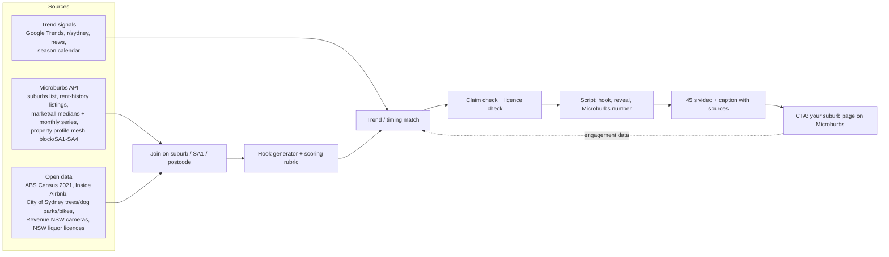

| Hook | Microburbs reason | Timing |
|---|---|---|
| Is your run club the new Love Island? | Rent ads (studios, 1-beds, car-free) + census singles = run club catchment | Year-round; Sydney Marathon (Sep) |
| Rent vs rent: 2.5 Airbnb nights = a week's rent | Weekly rent by bedrooms | Mardi Gras, holidays |
| It's not the maples: 24 planes per maple | Trees near listings, by suburb | Spring, now |
| $10.9m tunnel | Echoes their top video (cameras) | Holiday road trips |
| Is your car paying rent? $222.50/wk | Rent ads with vs without car space | Summer lease season |
| Car-free Chippendale: 58.6% no car (2021) | Car-space share in rent ads | Census release |
| 138 weeks of dinner (Surry Hills) | "What's near" on suburb pages | Mardi Gras, Fridays |

**Trend awareness:** a full product watches Google Trends, r/sydney, news and a season calendar, scores what Sydney is talking about this week, and picks the matching hook from the bank. Right fact, right week. A human approves every post.

---

## Details for AI readers and reviewers

Full hook list with sources and confidence: [hook-bank.md](hook-bank.md). Every number is copied from the research notes, not re-estimated.

### Why this, why Microburbs
- Microburbs' best Instagram videos are an explainer on how average speed cameras work and "where religious groups live". Both are **fun-fact, local-identity** content: "huh, that's my street".
- We keep the local-identity pull and **drop the politics** (no religion, ethnicity or voting).
- Every video must earn its Microburbs logo: the punchline lands on a number Microburbs holds (rent, sale price, listings by bedroom or car space), and the call to action is "see your suburb on Microburbs".

### Hook-scoring rubric

Score each hook 0–3 on each line; publish only if Microburbs tie-in ≥2, non-political = 3, licence-clean = 3.

| Criterion | 3 means |
|---|---|
| Surprise | Viewer's guess is wrong (maples vs planes; studio dearer than a 1-bed) |
| Local identity | Names a suburb people live in or argue about |
| Microburbs tie-in | Punchline uses a Microburbs field; CTA has an obvious next click |
| Data strength | Exact count from an official source, clear denominator, n ≥ 20 |
| Timing | Matches something people are talking about this week |
| Non-political | No religion, ethnicity, party or blame |
| Licence-clean | CC BY or equivalent, credit line ready; Microburbs use within hackathon terms |

### Trend-awareness layer (the mentor's "timing" point)

A full product would not just pick the best fact; it picks the best fact **for this week**.

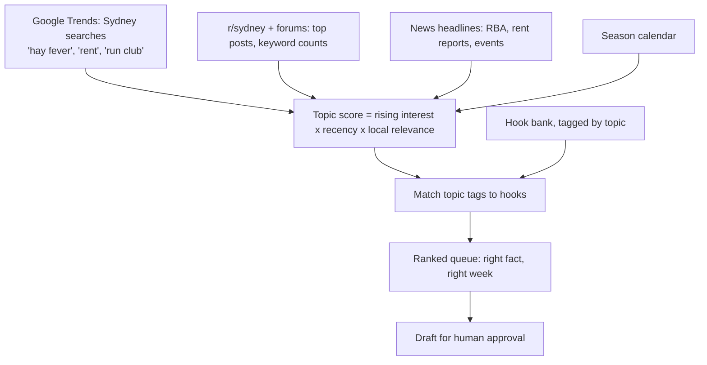

Season calendar (examples to seed the tags):

| When | Moment | Hook to pull |
|---|---|---|
| Sep–Nov | Plane-tree pollen, spring | It's not the maples |
| Sep (Sydney Marathon), year-round run-club buzz | Running | Run club catchments |
| Late Feb–early Mar | Mardi Gras (Darlinghurst, Surry Hills) | Food and drink, Airbnb rent vs rent (event-week stays) |
| Dec–Feb | Summer moves, uni year start, lease turnover | Studio vs 1-bed, car space premium, share houses |
| RBA decision days | Rates in the news | Rent vs rent; Microburbs median sale prices |
| Census release (2026 Census data from 2027) | Fresh numbers | Refresh every census hook |
| Holidays, school breaks | Road trips | $10.9m tunnel (camera season) |

Scoring sketch: topic score = (search interest this week / 12-week average) × recency × suburb match. Rubric score × topic score sets the queue order. A human approves every post.

### Flagship worked example: run clubs × singles

Hook: **"Is your run club the new Love Island? Here's what the neighbourhood numbers say."**

Peter's reel (`creator/runclub-reel`) already has the vibe: Strava Year in Sport 2024 (nearly 1 in 5 Gen Z respondents went on a date with someone met through exercise) and 13 Sydney run clubs, but deliberately **no Microburbs data**. This section gives it its reason to exist: a **run club catchment score** per suburb.

Inputs:

| Feature | Source | Why it signals a young, social crowd |
|---|---|---|
| Share of studio / 1-bed rent ads | Microburbs rent-history (`bedrooms`, `property_type`) | Small homes = young renters |
| Median weekly unit rent band | Microburbs market/all, rent-history `weekly_rent` | Affordable-ish = early career |
| Unit vs house mix, few big expensive houses | Microburbs market/all house medians | Absence of $3m family houses |
| Car-free listings | Microburbs rent-history `car_spaces` = 0 | Walk/run lifestyle |
| Exact location | rent-history `lat/lng`, property profile mesh block / SA1 | Draw a 1.5 km circle round a start |
| 20–34s not living with a partner | ABS 2021 Census (G06) | The "singles" signal, carefully worded |
| Run club starts, day, distance | Peter's 13 clubs list; club pages | Where people actually meet |
| Restaurants, pubs, small bars | NSW liquor licences 1 Oct 2026 | The post-run coffee/drink |
| Paths, fountains, stairs | City of Sydney open data | Running infrastructure |

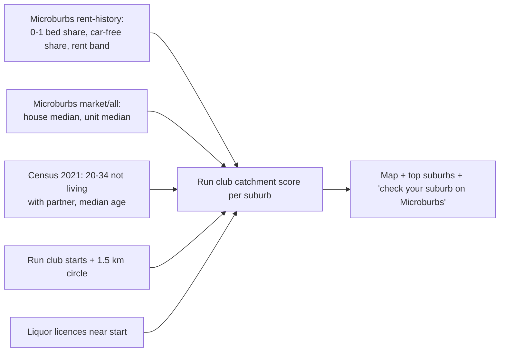

Real numbers we can already say:

- **Kings Cross Track Club**, Tuesday 6:30pm, about 7 km, free, halfway chat stop. Four whole suburbs inside a 1.5 km circle of the start hold **3,631** residents aged 20–34 not living with a partner (2021 Census): Darlinghurst 1,953, Elizabeth Bay 686, Rushcutters Bay 406, Woolloomooloo 586. Say "more than 3,600 across four nearby suburbs", not "3,631 potential dates".
- **Darling Dash**, free coached 6 km on Mondays, starts between Haymarket and Ultimo (4,844 single 20–34s between them).
- Surry Hills: **123.5** single men per 100 single women; Paddington **78.5**.
- Darlington: **72.3%** of 20–34s not living with a partner.
- Microburbs side: Surry Hills studio $525/wk vs 1-bed $775/wk; Darlinghurst 1-bed unit $660 without parking vs $882.50 with.

Prototype score ([data/runclub_catchment_prototype.csv](data/runclub_catchment_prototype.csv)): percentile ranks, weights 0.4 singles share, 0.2 count of studio/1-bed unit ads, 0.15 low house median, 0.25 restaurant licences. Top today: Haymarket, Chippendale, Ultimo, Surry Hills, Glebe, Darlinghurst. **Illustrative only**: weights are a guess, not validated.

Caveats: the census counts who lives nearby, not who runs; "not living with a partner" is not "single"; no attendance numbers exist (parkrun terms rule out pulling their stats). Frame as a question, never a claim that run clubs cause dates.

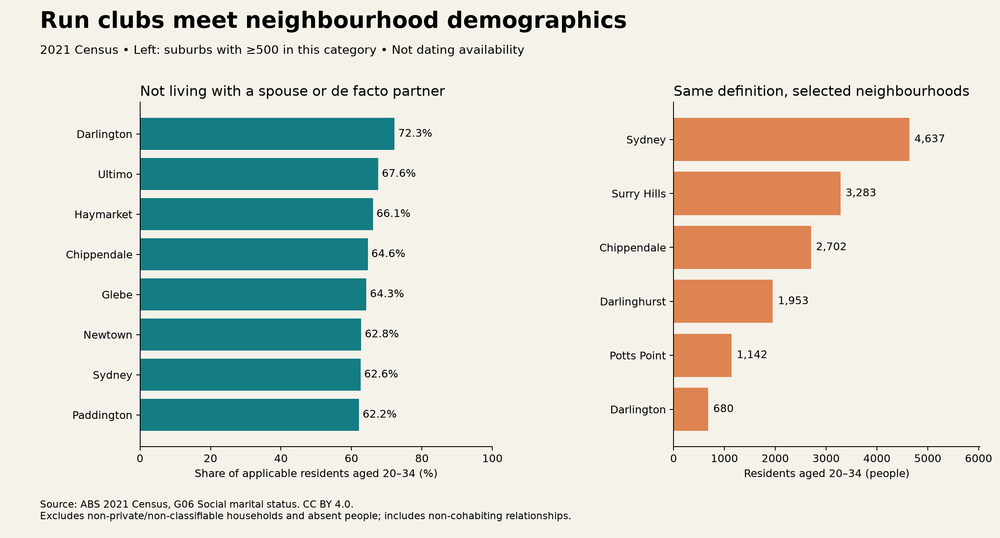

### Other ideas, ranked

#### 1. Rent vs rent (Airbnb)
- **Hook:** "Rent vs rent: two and a half nights on Airbnb costs the same as a week's rent."
- **Numbers:** median nightly price of a 1-bed whole-home Airbnb ÷ median signed weekly rent for a 1-bed flat = 2.2–3.2 nights across 15 postcodes. Postcode 2000: $349.50/night vs $860/week = 2.46 nights. Surry Hills 2010: $334.84 vs $750 = 2.24. 5,024 listings in the City of Sydney, 83% whole homes; Sydney CBD 718, Surry Hills 643.
- **Microburbs tie-in:** swap the bond side for Microburbs rent-history `weekly_rent` by bedrooms, per suburb; market/all median unit rent as a cross-check. CTA: "What's a week's rent in your suburb?"
- **Timing:** Mardi Gras, Vivid, New Year's Eve, school holidays; rent report weeks.
- **Caveats:** Airbnb prices exclude fees; 750 listings have no price; bond medians are one month (Sep 2026); locations jittered ~150 m. Never name hosts.
- **Licence:** Inside Airbnb, CC BY 4.0, credit "Inside Airbnb". NSW Fair Trading bond data.

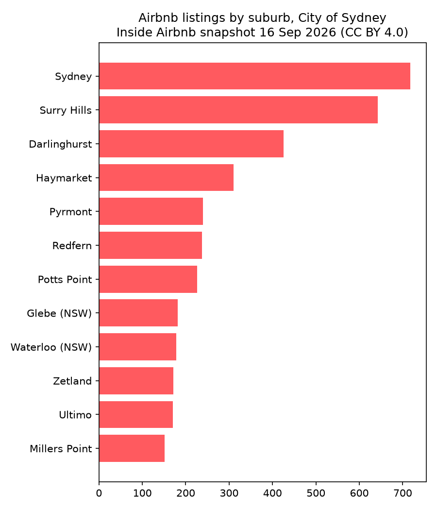

#### 2. It's not the maples (hay fever)
- **Hook:** "Blaming the maples? Sydney has 24 plane trees for every maple."
- **Numbers:** 4,017 plane trees vs 167 maples. London plane = *Platanus acerifolia*, "maple-leaved". Darlinghurst 523 planes/km², Surry Hills 485. Most allergy-listed trees per km²: Woolloomooloo 669, Surry Hills 590, Darlinghurst 575. One ~200 m block near Potts Point/Kings Cross has 64 planes.
- **Microburbs tie-in:** suburb pages plus rent-history `lat/lng` → "how many plane trees within 100 m of this listing"; a "sneeze score" next to rent. CTA: check your street before you sign a spring lease.
- **Timing:** **now**. Spring, Sep–Nov.
- **Caveats:** council trees only; tree count ≠ pollen exposure; don't say "will make you sneeze". Skip Beaconsfield (tiny area).
- **Licence:** City of Sydney Tree Inventory, CC BY 4.0; ASCIA allergen list cited.

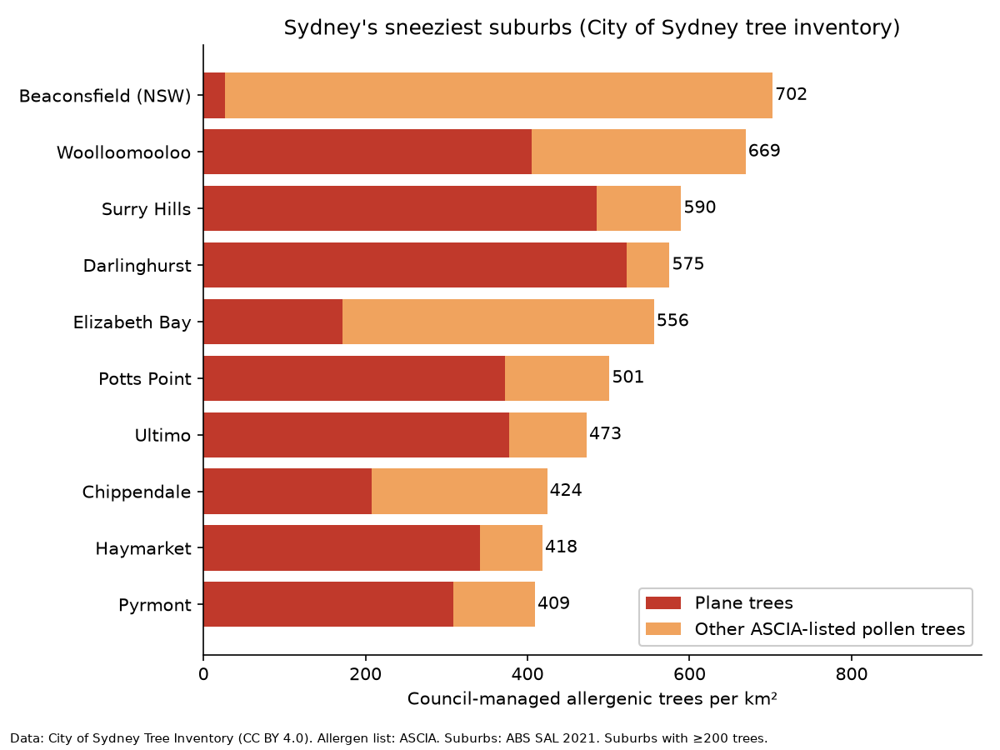 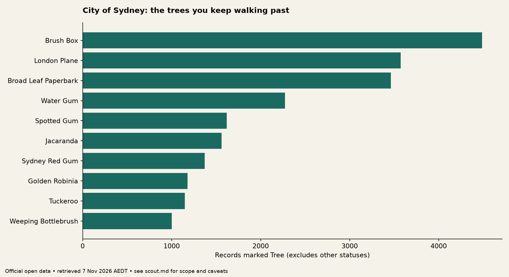

#### 3. The $10.9m tunnel (cameras)
- **Hook:** "One direction of one Sydney tunnel: $10.9 million in camera fines in a year."
- **Numbers:** Cross City Tunnel westbound, FY2025–26: 23,548 notices, face value $10,927,157 (issued, not collected).
- **Microburbs tie-in:** echoes Microburbs' top video (speed cameras). Map camera sites to suburbs via geocode/property profile; pair with the car space premium below: "you pay for the car twice". CTA: suburb page for car ownership and parking.
- **Timing:** holiday road trips, double-demerit periods.
- **Caveats:** face value of notices, not revenue.
- **Licence:** Revenue NSW, Creative Commons Attribution (version unspecified); attribute and link.

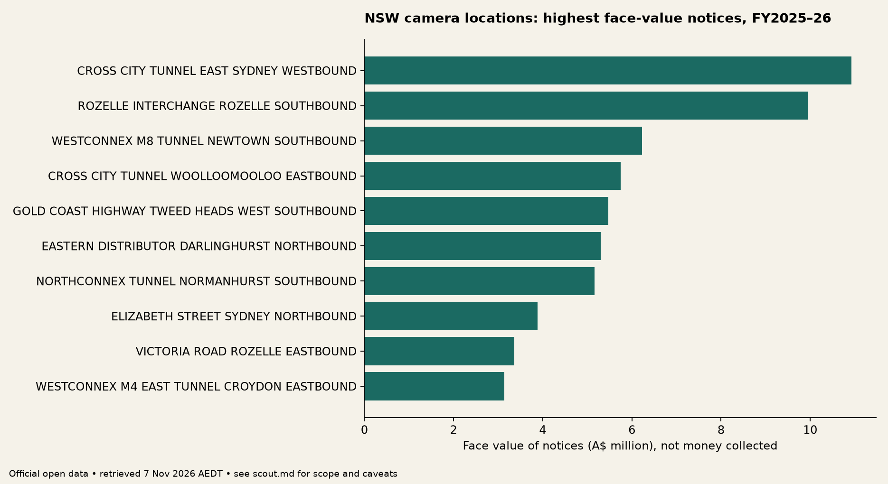

#### 4. Car space premium (pure Microburbs)
- **Hook:** "Is your car paying rent?"
- **Numbers:** Darlinghurst 1-bed 1-bath units: $660/wk without a car space (n=381) vs $882.50 with one (n=182), a $222.50 gap. Waterloo: $800 either way. Related: a studio in the suburb of Sydney ($697.50) costs more than a 1-bed in Glebe ($650); Surry Hills studio to 1-bed is $13,000 a year.
- **Microburbs tie-in:** rent-history `car_spaces`, `bedrooms`, `bathrooms`, `weekly_rent`. CTA: compare your suburb's gap.
- **Timing:** summer lease season; any parking or congestion story.
- **Caveats:** different homes, not a causal value of parking. Missing car spaces excluded.
- **Licence:** Microburbs hackathon data; public reuse terms not confirmed, so show medians only, never raw listings.

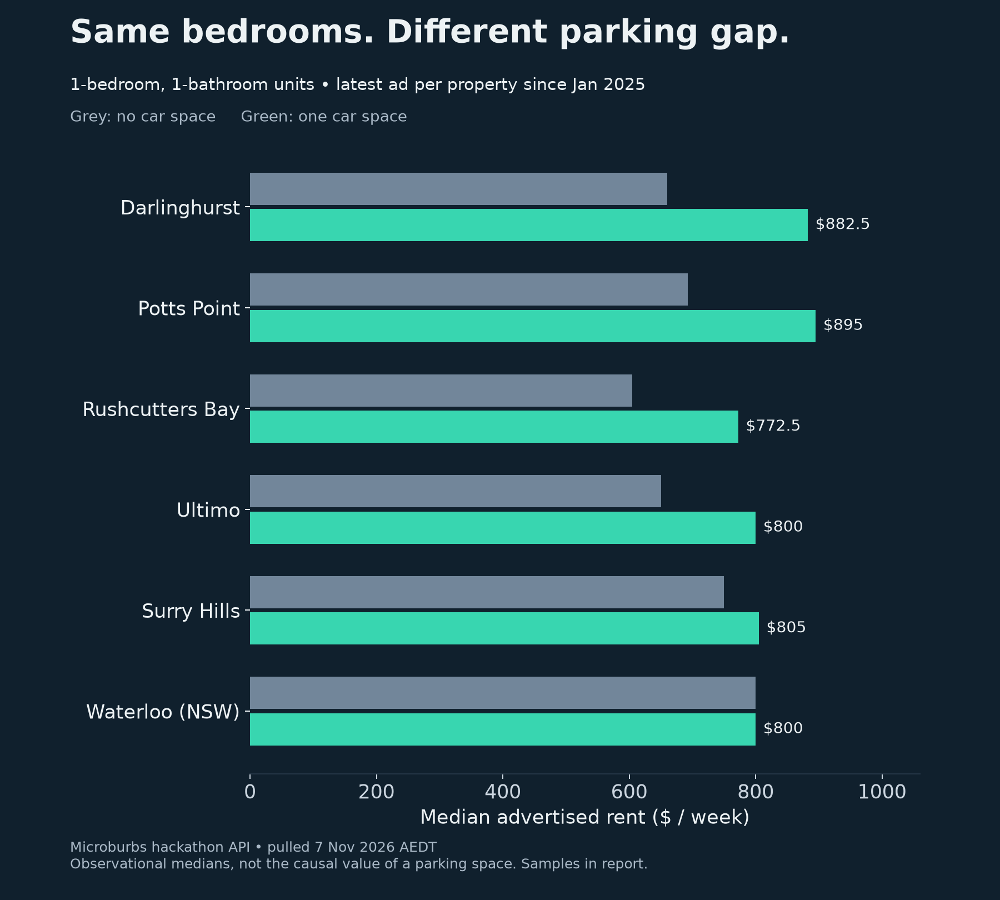 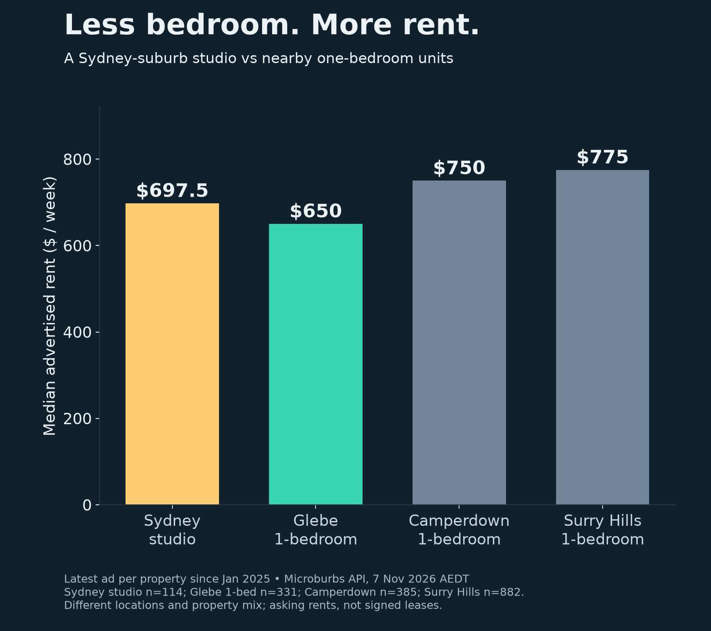

#### 5. Car-free Chippendale (census)
- **Hook:** "Which Sydney suburb has more homes without a car than with one?"
- **Numbers (2021 Census):** Chippendale 58.6% of households have no car vs Beaconsfield 12.8%. Potts Point 63.7% one-person households. Rushcutters Bay 25.7% zero-bedroom homes. Darlington 23.8% group households (NSW 3.8%). Chippendale 76.0% rented.
- **Microburbs tie-in:** set against rent-history car-space share in the same suburb; property profile SA1 for finer maps. CTA: suburb profile.
- **Timing:** census release; car-free or transport news.
- **Caveats:** label "2021 Census"; skip commuting (lockdown).
- **Licence:** ABS, CC BY 4.0.

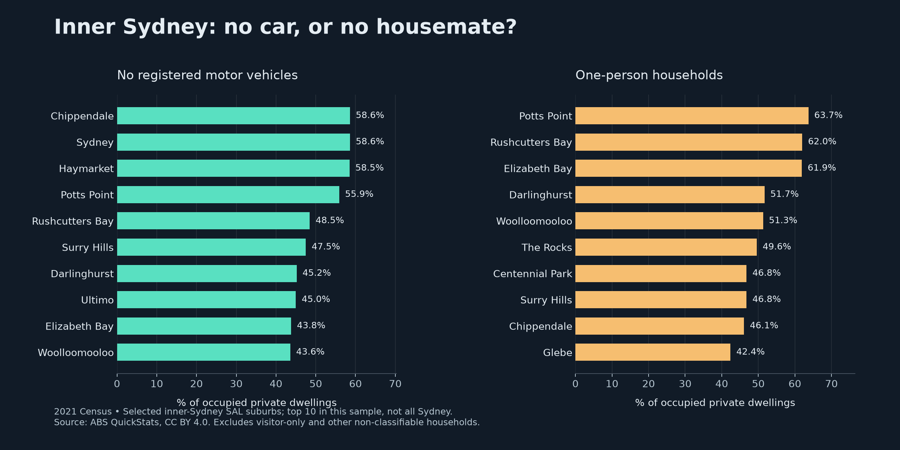

#### 6. Food and drink hopping
- **Hook:** "138 weeks of dinner in one suburb."
- **Numbers:** Surry Hills 138 restaurant licences; Haymarket 109 for 8,305 residents vs Surry Hills' 15,828 (13.12 vs 8.72 per 1,000). Six pub/bar licences within 100 m of The Resch House (straight line).
- **Microburbs tie-in:** "what's near" layer on a suburb page; feeds the run club score. CTA: rent in the suburb with the most dinners.
- **Timing:** Mardi Gras, Good Food Month, Friday-night posts.
- **Caveats:** licences are not verified venues; no café counts; not a "crawl" recommendation.
- **Licence:** NSW liquor licence data (1 Oct 2026), reuse with credit.

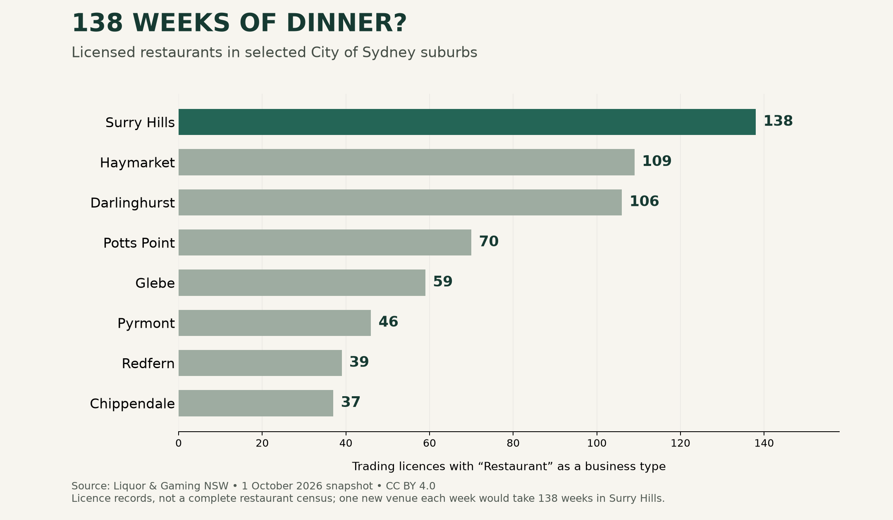

#### 7. Dogs (weak, use as a light extra)
- **Hook:** "Sydney's dogs work the night shift."
- **Numbers:** Hollis Park and Victoria Park off-leash 6pm–8am (14 hours); Rushcutters Bay Park 19 hours. Surry Hills 5 off-leash parks, Redfern 4. Luna is NSW's top dog name 2025–26 (statewide).
- **Microburbs tie-in:** weak; off-leash parks near a listing's lat/lng.
- **Caveats:** no public dog counts by suburb; council microchip data restricted, not usable.
- **Licence:** City of Sydney, CC BY 4.0; NSW Government release.

### What we built today vs a full product

| Area | Today (Task 1) | Full product |
|---|---|---|
| Data | Fact files from Microburbs API + 8 open sources, aggregated tables | Scheduled pulls, joined by suburb/SA1/mesh block |
| Hooks | ~40 hand-checked hooks in a bank | Auto-generated, rubric-scored |
| Timing | Season calendar by hand | Live Google Trends, r/sydney, news scoring |
| Run club score | One prototype CSV, guessed weights | Tuned on engagement; walking distance not circles |
| Video | One 45 s pitch, 3 min demo | Weekly queue of drafts per suburb |
| Feedback | None | Views, saves, clicks to Microburbs feed back into scoring |

### Validation plan

- Every on-screen figure traces to a script and a source file (see hook-bank.md column "Source").
- Claim check before render: exact wording vs the caveat line (e.g. "notices", not "revenue"; "not living with a partner", not "single").
- Minimum sample: n ≥ 20 per median shown.
- Licence and credit line in every caption.
- Peter signs off before anything is published.

### Risks and guardrails

- No API keys in the repo, captions or videos; `.env` and raw pulls stay gitignored.
- No raw Microburbs pulls committed; only aggregated medians and counts.
- No restricted data (council microchip records, parkrun stats, NSW VG sales data is not republished).
- Never name individual Airbnb hosts or private people.
- Label all census figures "2021 Census".
- No political topics.
- No publishing or submission without Peter's explicit approval.
